# ArMoney  -  System and Agent Team Architecture

> The main project map, updated 2026-10-13 from main
> `ce5175bbf2d4183b16f76977ef6f7627c2ed5ee2`, including the assistant release in PR #46.
> Exact-head checks and deployment evidence are recorded separately in that PR.
> Describes the source code, not the guaranteed state of running containers.
> This revision adds the #30 Saga design and #31 optional Kafka infrastructure
> source; Kafka cluster acceptance and deployment remain unverified.

## Navigation

1. [Readiness and stack](#readiness-and-stack)
2. [Services and runtime](#services-and-runtime)
3. [API and authentication](#api-and-authentication)
4. [Data and ledger](#data-and-ledger)
5. [Phone P2P and notifications](#phone-p2p-and-notifications)
6. [Agent team](#agent-team)
7. [Communication and remediation](#communication-and-remediation)
8. [Verification and delivery](#verification-and-delivery)
9. [Keeping documentation current](#keeping-documentation-current)

## Readiness and stack

A banking backend with service boundaries for identity, profiles, wallets, payments, and ledger accounting.
**M1 is the first functional milestone:** authorized public P2P, durable recovery,
phone recipient confirmation, and a native client. Completion requires passing
exact-revision CI and independent review; source implementation is not deployment evidence.

| Area | Current state | Next steps |
| --- | --- | --- |
| Auth | Password login and Keycloak exchange, stable local identities, opaque sessions | Global provider logout/revocation integration |
| SSO | Optional Keycloak realm, browser authorization code + PKCE | Production identity controls, MFA, email verification |
| iOS | Existing native SwiftUI login, wallets/balances, transfers/history, notifications and profile (iOS 18+); feature development paused | Physical iPhone validation and regression CI paused by owner |
| Android | Native Kotlin/Compose SSO, wallets/balances, phone transfers/history, inbox and profile (API26+) | Physical-device/LAN acceptance; exact-revision CI evidence in the delivery PR |
| User | Profile, optional immutable email-prefix sharding and central unique UAE registration-phone directory | Prefixes do not guarantee uniform load; automated ownership proof requires a separate approved provider |
| Wallet | Metadata, durable ledger provisioning, owner-scoped live balances | Lifecycle controls |
| Ledger | Private accounts, balances, atomic postings; optional two direct physical standbys and fenced balance reads | Manual failover; production HA and backup/PITR |
| Payment | Durable P2P, requester idempotency, recovery, history, in-app notifications and transactional Mailtrap email outbox | Email disabled until configured; real sending requires verified contact; duplicates possible after ambiguous provider acceptance |
| AI assistant | Implemented read-only C# service, local policy RAG, constrained bank reads and Android screen; local rollout verified on 2026-10-13 | Finite demonstration topics, English extracts, at most six wallets and first-page history of 50; physical-device/live-owner acceptance not run |
| Gateway | Auth, profile/phone, wallets/balances, P2P and notifications | Further hardening |
| Local SMS sandbox | Optional authenticated capture API and web inbox, bounded persistent file storage; no carrier delivery | Identity OTP and transaction producers are separate integration tasks |
| Kafka infrastructure | Optional source-defined three-controller/three-broker KRaft cluster, mutual TLS, exact service ACLs and cold snapshot helper | Real-cluster acceptance and deployment pending; service adapters and financial Saga recovery remain planned |

A payment email presentation candidate adds HTML/plain text and a frozen optional
profile display name; it is not yet validated on current CI or deployed. Auth
remains the destination-verification authority. See [ADR 0030](docs/adr/0030-transaction-email-presentation.md).

Java 21, Gradle multi-project, Javalin, PostgreSQL, Flyway, jOOQ, HikariCP;
Spock, Testcontainers, ArchUnit; REST/OpenAPI; Docker Compose, GitHub Actions.
Exact versions: [build.gradle](build.gradle), [runtime build](platform-runtime/build.gradle),
[Gradle wrapper](gradle/wrapper/gradle-wrapper.properties), [Compose](compose.yaml).
Spring, Redis and Kubernetes are not implemented. Optional Kafka infrastructure
is defined separately in [compose.kafka.yaml](compose.kafka.yaml); the banking
services still use their existing HTTP transport. Native iOS uses SwiftUI; Android uses Kotlin and Jetpack Compose;
Keycloak and Caddy are optional container services, configured by compose.sso.yaml.

### Proposed Kafka and Saga direction

[ADR 0022](docs/adr/0022-kafka-payment-saga.md) and the
[message and recovery contract](docs/kafka-saga-contract.md) define the future
messaging direction. The following business flow is **planned, not implemented**;
the current payment worker still calls Ledger over HTTP. No Kafka service
adapter, financial inbox/outbox or Saga table is introduced by #31.

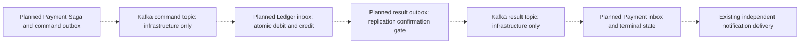

Payment and Ledger retain separate local PostgreSQL transactions. Ledger is
unsharded; its physical standbys replicate one primary, while user profile shards
are a different data boundary. Stable payment IDs, authoritative confirmation
and reconciliation remain required. Broker acknowledgements, timeouts and
notification failures cannot establish completion or initiate refunds.

## Services and runtime

The optional [SMS sandbox](docs/sms-sandbox.md) runs from `compose.sms.yaml` on
a dedicated Docker bridge network with loopback-only ingress. It has its own persistent
volume and independent sender/reader credentials. It is not connected to the
identity or payment flows yet; see [ADR 0020](docs/adr/0020-local-sms-sandbox.md).

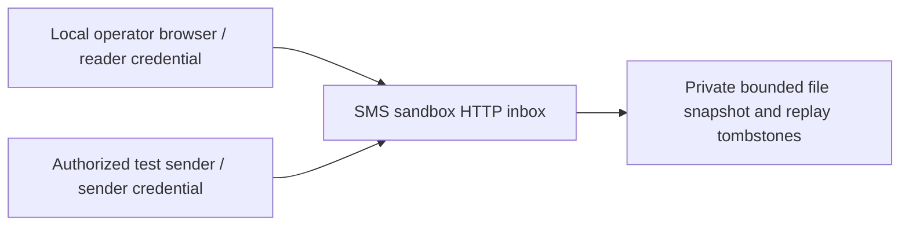

No external SMS provider is called. The sandbox does not decide whether an OTP
is valid and is not a production delivery or multi-instance messaging service.

### Optional private Kafka infrastructure

[ADR 0024](docs/adr/0024-local-kafka-infrastructure.md) and
[Kafka operations](docs/kafka-operations.md) describe #31's source-defined
infrastructure. An explicitly selected Compose project has three dedicated KRaft
controllers, three brokers and six project-scoped storage volumes, using the
pinned Apache Kafka image. It has a separate internal network, no published host
ports and no connections to banking networks or databases.

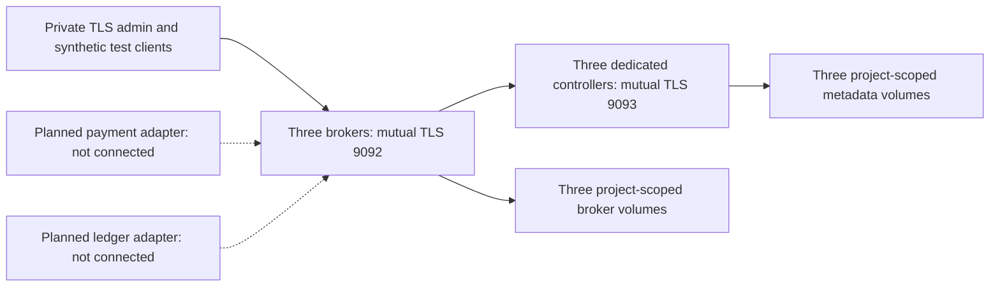

TLS authenticates distinct node/application principals; default-deny ACLs allow
payment commands and ledger results only for their owning producers/consumer
groups. Node/admin credentials are cluster-wide authority; applications are not
superusers. Each container mounts only its credential directory read-only, with
the signing CA excluded. Explicit formatting and identity-checked startup protect
storage from automatic reinitialization. Topics use three replicas, minimum ISR
two and disabled unclean election; this configuration is not measured durability.

The cold snapshot helper checks node/cluster metadata, exact directory/file
inventory and hashes. Its caller must prove all six nodes stopped, validate
resource ownership and restore to empty volumes in a separate project. Offline
synthetic file tests do not establish real Kafka recovery or RTO/RPO. The CI job
must run the isolated failure and restore suite before runtime acceptance; this
map makes no deployed-cluster readiness claim.

The orchestrator owns Kafka Compose/CI, storage and security configuration and
this map. Payment/ledger owners own future service adapters; independent QA and
the security auditor verify transport/recovery and trust boundaries, followed by
the independent reviewer of the integrated revision.

**Base backend connections are shown below; the optional native-client SSO edge is described separately.** Wallet provisions accounts through the
private ledger API. Payment validates user/wallet mappings and posts through ledger.

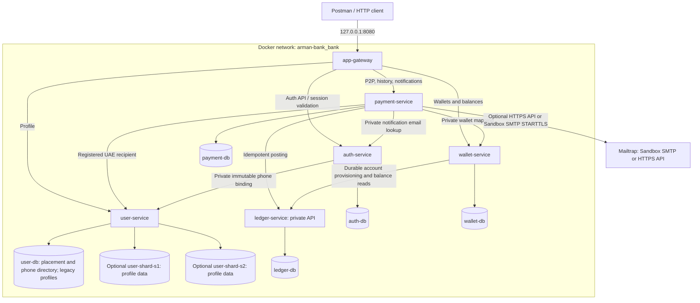

| Module | Responsibility | Boundary |
| --- | --- | --- |
| app-gateway | External routes, session validation, header sanitization | No database or financial logic |
| auth-service | Credentials, SSO identity mapping, sessions, limits | Does not own profiles |
| user-service | Profile placement, sharded display names and central registered UAE phone directory | Does not issue tokens or claim SMS proof; owns all profile shards |
| wallet-service | Owner, currency, lifecycle and durable ledger mapping | Not the source of balances |
| payment-service | Transfer intent, client idempotency, recovery, notifications and email outbox/dispatcher | Completion requires matching ledger confirmation; email failure never changes money |
| ledger-service | Accounts, balances, immutable paired postings | No public funding API |
| platform-runtime | HTTP lifecycle, DB wiring, migrations, health | A library, not a separate service; no shared business entities |

### Code boundaries

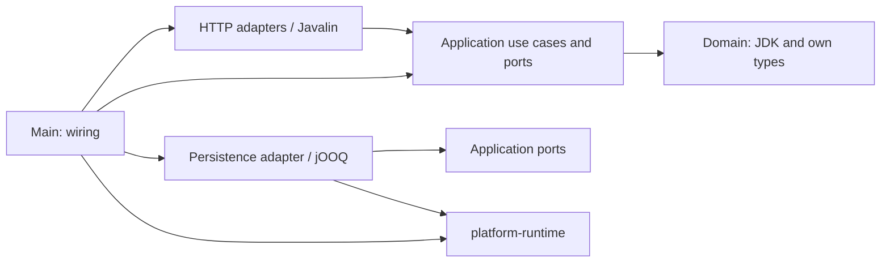

This is a rule for organizing use cases, not a claim that every scaffold contains all
layers. Ports are introduced for real dependencies. Services do not import each other's
Java code or read each other's databases. ArchUnit checks architectural constraints.

### Containers and local environment

Java container startup adds `infra/runtime/java-security.properties` to the JDK
security defaults. Positive, negative and stale JVM DNS caches are disabled for
dynamic Compose service names: restarted containers may exchange IP addresses.
The setting is container-scoped and does not replace the JDK security policy.


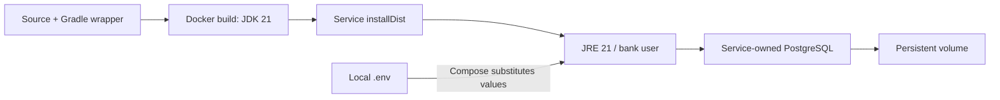

Inside Compose, services listen on 8080 and PostgreSQL on 5432. Base Compose publishes
only the gateway on loopback; the five databases have separate volumes. Flyway runs
while DB wiring is created, before the HTTP listener opens. Migration failure prevents startup.

Variables: `PORT`, `DB_URL`, `DB_USER`, `DB_PASSWORD`; protected internal APIs use
`INTERNAL_AUTH_KEY`; the gateway uses `AUTH_BASE_URL`, `USER_BASE_URL`, `WALLET_BASE_URL`, `PAYMENT_BASE_URL`.
Payment uses `USER_BASE_URL`, `WALLET_BASE_URL`, `LEDGER_BASE_URL`.
Auth also requires `USER_BASE_URL` for idempotent registration-phone binding.
Secrets come from local configuration; their values must not appear in documentation.
A regular Java launch **does not read `.env` automatically**: configure environment
variables/an env file in IDEA; Compose uses its own substitution mechanism.

The user's local `compose.override.yaml` exposes databases to DataGrip on
`127.0.0.1`: auth **5433**, user **5434**, wallet **5435**, payment **5436**, ledger
**5437**. This is not guaranteed configuration for a fresh clone: check your own
override. All database containers use `bank` as the database and user name; the password is local.
Restarting does not require deleting volumes. See [README](README.md) and [IDEA](docs/onboarding.md).

## Native clients and SSO

The optional overlay adds an HTTPS edge and a Keycloak-owned PostgreSQL database.
Caddy supplies default SNI from ARMONEY_HOST for clients using numeric IP origins; certificate name and CA validation still apply. Only the edge is bound to the selected LAN interface; the existing gateway binding
remains loopback. Keycloak administration and management paths are not exposed on
the LAN listener. An optional workstation-only override exposes the admin console
through Caddy at `https://localhost:9443`, bound to `127.0.0.1`; it uses a separate
admin hostname and master-realm frontend URL, preserving the ArMoney issuer.
See [local administration](docs/sso-and-ios.md#optional-host-only-administration).

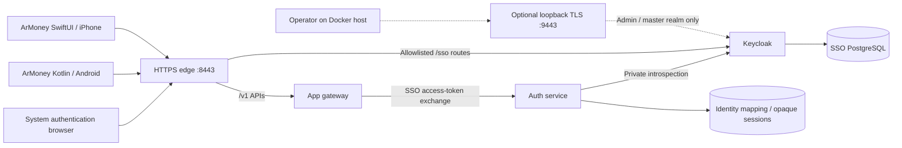

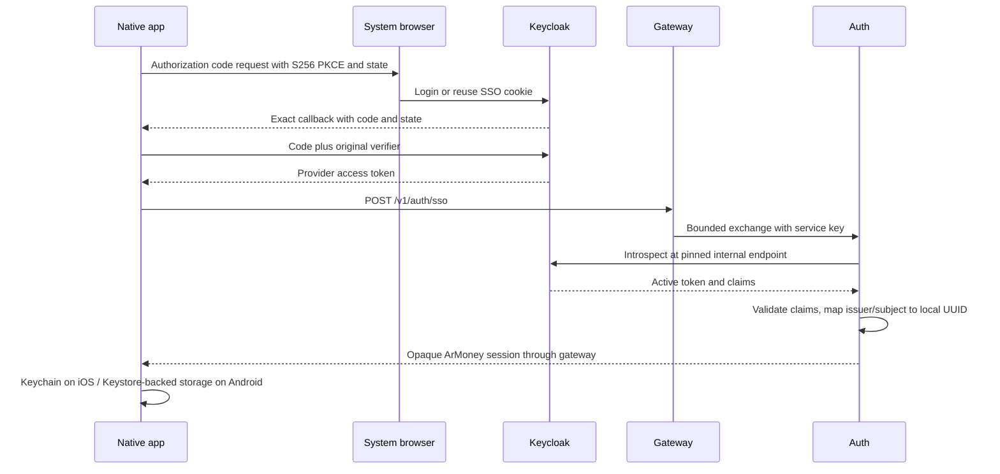

No identity is linked by email. Existing password identities and their wallet UUIDs
remain unchanged; SSO-only /auth/me responses have email=null. The client consumes
no ID-token claims or refresh tokens. Local sessions expire after 30 minutes;
provider logout/disablement does not immediately revoke issued local sessions.
Local logout and browser logout are separate operations, not global single logout.
The app supports profile onboarding and actual wallet PENDING/READY states, with
no fabricated balances or transfer success. TLS trust must be configured on each
Mac/iPhone/Android device; native code never bypasses certificate validation. See
[setup](docs/sso-and-ios.md), [iOS](ios/README.md) and [ADR 0008](docs/adr/0008-native-ios-and-keycloak-sso.md).

Android build/configuration and acceptance are described in [android/README.md](android/README.md),
[Android contract](docs/android-contract.md) and [ADR 0010](docs/adr/0010-native-android.md).
The native presentation uses the semantic light/dark tokens documented in
[Android design](docs/android-design.md); device visual acceptance remains separate
from JVM contrast checks and successful compilation.
The Android public client uses its own exact callback; both native clients map the
same issuer/subject to one bank identity. No new financial service is introduced.

## API and authentication

Contracts are in each service's `src/main/resources/openapi.yaml`.
`/openapi.yaml` serves YAML, not Swagger UI. `/` is not a user interface.

| Access | Method and path | Purpose |
| --- | --- | --- |
| Gateway | POST `/v1/auth/register`, POST `/v1/auth/login` | Registration / session |
| Gateway | POST `/v1/auth/sso` | Provider-token exchange; requires optional SSO configuration |
| Gateway + Bearer | GET `/v1/auth/me`, POST `/v1/auth/logout` | Identity / revocation |
| Gateway + Bearer | GET / PUT `/v1/users/me` | Own profile |
| Gateway + Bearer | GET / POST `/v1/wallets`, GET `/v1/wallets/{id}/balance` | Own wallets and live balances |
| Gateway + Bearer | PUT `/v1/users/me/phone`, POST `/v1/recipients/resolve` | Immutable registration phone and exact registered-recipient lookup |
| Gateway + Bearer | POST / GET `/v1/payments`, GET `/v1/payments/{id}` | Idempotent transfers and participant history |
| Gateway + Bearer | GET `/v1/payments/page`, GET `/v1/notifications/page` | Owner-bound cursor pages |
| Gateway + Bearer | GET `/v1/notifications`, POST `/v1/notifications/{id}/read` | Own in-app inbox |
| Private ledger | POST `/v1/ledger/accounts`, GET `/v1/ledger/accounts/{id}` | Account and balance |
| Private ledger | POST `/v1/ledger/transfers`, GET `/v1/ledger/transfers/{id}` | Posting/replay and outcome |
| Each service | GET `/health/live`, `/health/ready`, `/openapi.yaml` | Operational endpoints |

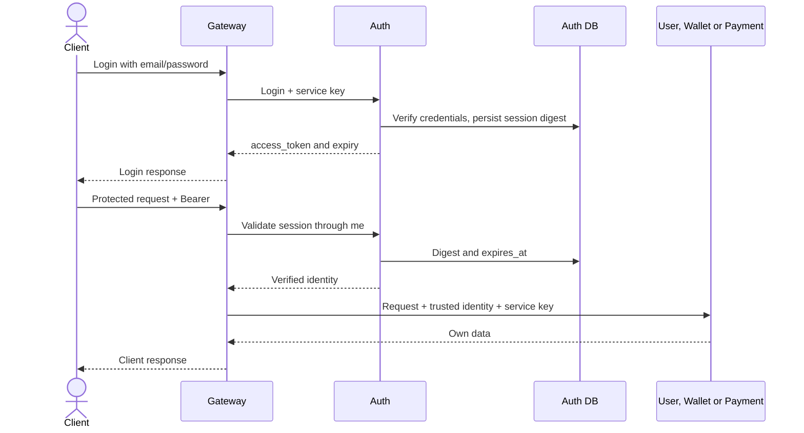

Passwords are protected with Argon2id. The token is a random opaque string, not a JWT;
`sessions` stores its SHA-256 digest. Sessions last 30 minutes; logout deletes the session.
The gateway validates every protected business request through auth, replaces the client's
identity with the trusted identity, and does not forward the bearer token to user/wallet/payment.
Authorization failure blocks the request.

Only profile PUT receives `X-Identity-Email`, derived from the authenticated auth
response and normalized by the gateway. Client email headers are discarded;
malformed auth email metadata fails closed. Missing/null email is valid for SSO
and uses the configured profile default shard.

Ledger requires `X-Service-Key` and a trusted `X-Identity-Id`; the gateway does not proxy it.
The shared service key does not isolate compromised services from one another.
A persistent service's readiness checks its own database; user-service checks the
primary directory and all configured profile shards. Gateway readiness checks
only the gateway itself. `UP` does not prove downstream availability or P2P correctness.

## Data and ledger

### User profile placement

Optional [profile sharding](docs/adr/0012-user-profile-sharding.md) selects a physical
database at the first profile PUT using two normalized email characters and a
configured prefix map. The primary directory permanently pins identity UUID,
profile UUID and shard. Existing profiles are backfilled as `primary` without
moving data. Changes to email or the map affect no previously pinned identity.
Missing or unavailable assigned databases never trigger fallback writes.

Registration remains in auth-service and binds a central phone claim through
user-service; it does not provision a profile or choose a shard. Unmapped,
non-alphanumeric prefixes and email-less identities use the configured default.
The directory, registration claims, global phone uniqueness, attestation audit and lookup quota remain
centralized. Reservations and shard writes are separate durable transactions;
failed first writes require retry with the same pin. Prefix placement does not
guarantee balanced load or remove the primary directory dependency.

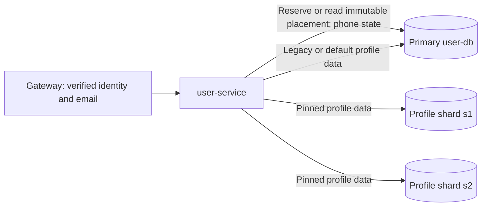


UUIDs shared across services are **logical references**, not cross-database foreign keys.
`owner_id` means the auth identity UUID, not the profile ID.

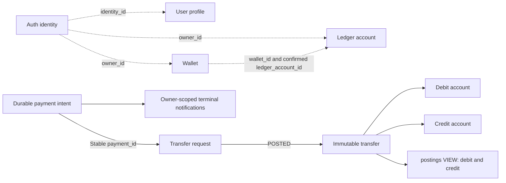

| Database | Tables / guarantees |
| --- | --- |
| auth-db | `identities`: separate notification email and provider verification flag; nullable email/password_hash pair for SSO-only principals, unique non-null email and registration_phone (null for historical unenrolled users); `external_identities`: (issuer, subject) PK and unique local identity mapping; `sessions`: token_hash PK, FK identity_id, expires_at; `auth_attempts`: persistent limits |
| user-db | Existing `profiles` remain in place; `profile_directory` pins identity/profile UUID and shard and owns authoritative globally unique non-null phone state; `registration_phone_claims` binds unique identity and UAE phone before profile creation; operator audit and persistent lookup quota remain central |
| Optional user shards | `profiles`: display name keyed by pinned profile/identity UUID; phone state is overlaid from the primary directory |
| wallet-db | `wallets`: unique(owner_id,currency), AED, ACTIVE/CLOSED, PENDING/READY, unique ledger_account_id, durable retry lease; no balance |
| payment-db | `payments`: unique(requester_id,idempotency_key), request_hash, wallet IDs, amount/currency, PENDING/COMPLETED/REJECTED, recipient/account snapshot, fenced lease/backoff; notifications and email outbox unique(owner,payment,type); durable email leases, attempts and delivery outcomes |
| ledger-db | `accounts`: unique wallet_id, owner, CUSTOMER/CLEARING, balance_minor; `transfers`: payment_id PK and account/currency FKs; `transfer_requests`: durable payload/outcome; `postings`: view |
| Every database | `flyway_schema_history`: technical record of applied migrations |

Accounts referenced in transfer_requests do not have to exist: this table also preserves
rejections. `accounts.wallet_id` is not yet validated through an HTTP request to wallet-service.
Exact columns, indexes, and constraints are defined in service migrations; published
migrations are append-only. The current DB owner has administrative capabilities:
triggers do not protect against an administrator. A restricted runtime DB role is future work.

### Optional ledger replicas

`compose.ledger-replication.yaml` preserves `ledger-db` and adds two direct
PostgreSQL physical hot standbys. Application commits require WAL flush on at
least one synchronous standby. Only account/balance reads can use replica pools:
each query checks database/cluster/timeline/recovery identity and a primary WAL
replay fence, then falls back to primary when unavailable or stale. Provisioning,
posting and durable result lookup stay primary. Replicas never run Flyway.
The replicated profile requires an explicit post-transaction quorum WAL flush
confirmation before acknowledging provisioning or new/replayed payment results.
This prevents cancellation/restart recovery from returning a locally committed
but unreplicated result. Missing confirmation stays unavailable/uncertain.

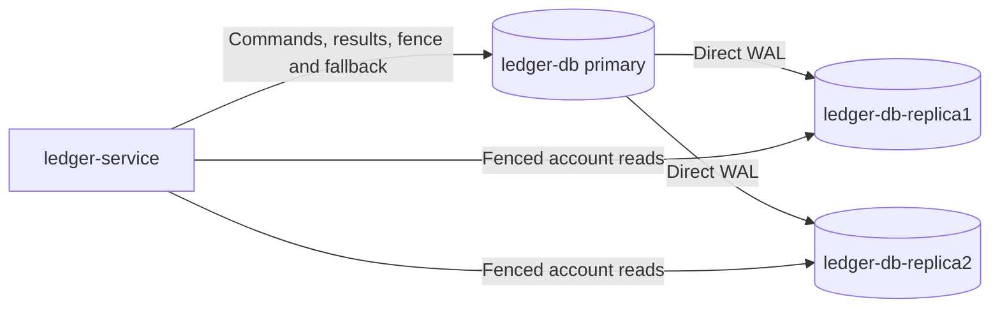

Read routing requires primary availability; it does not provide automatic outage
reads. With both synchronous replicas unavailable, commit acknowledgement waits;
timeouts retain uncertain command semantics. Promotion, fencing, reparenting and
application pool reconfiguration are manual. No HA manager, failover proxy or
production backup/PITR is introduced. Containers sharing one host are not independent
host failure domains. See [ADR 0013](docs/adr/0013-ledger-replication.md) and
[operations and disposable acceptance](docs/ledger-replication.md).

### Atomic posting  -  implemented

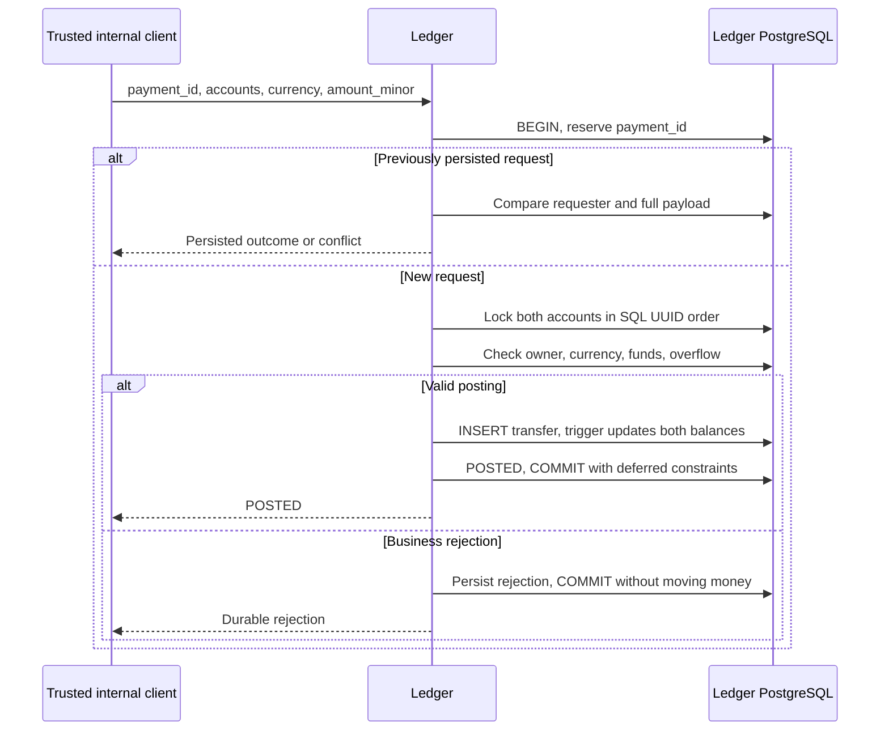

AED is the only supported currency. Money is represented as integer fils: `100` equals
1 AED. Wallet creation, payments and ledger posting reject other currencies.
Append-only migrations enforce this rule and refuse non-AED historical data without
conversion; see [ADR 0011](docs/adr/0011-aed-only.md). The amount must be positive, CUSTOMER balances cannot be negative,
and overflow is prohibited. One immutable transfer produces two opposite entries in the
postings view. The posting, balances, and terminal result commit in one PostgreSQL transaction.
Deferred constraints prevent committing an unfinished PENDING request.

A retry uses the same `payment_id`, requester, and payload; a changed request produces
a conflict. A durable insufficient-funds rejection remains a rejection even after later
funding. After a timeout, retry or look up **the same ID**: no response does not mean rollback.
A transaction failure rolls back its changes.
POST: 200 POSTED, 409 rejection/conflict; outcome GET: 200 even for a persisted rejection,
404 for a missing result or one belonging to another requester. Accounts open with zero balance.
There is no funding API; CLEARING fixtures are used only in isolated tests.
Details: [ledger](docs/ledger.md), [ADR 0005](docs/adr/0005-atomic-ledger.md).

### Durable wallet provisioning  -  implemented

POST /v1/wallets commits intent and returns 202 for ACTIVE/PENDING, or 200 for READY
and existing CLOSED wallets. GET includes provisioning_status and nullable
ledger_account_id. ACTIVE alone is not readiness: payments require READY.
Wallet requires LEDGER_BASE_URL (Compose supplies http://ledger-service:8080).

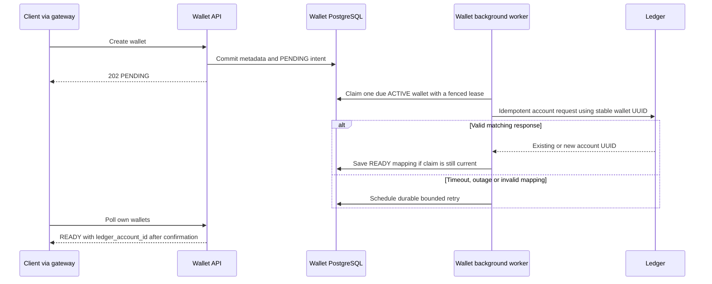

The worker processes up to ten sequential claims per tick with no transaction held
across HTTP. Each claim has a 30-second lease; stale workers are fenced by a token.
The scheduler ticks after a one-second fixed delay. Failed attempts back off through
2/4/8/16/32/60 seconds; pending work is retained, not silently abandoned. HTTP has
2-second connect, 5-second request and 6-second whole-response deadlines and a 4 KiB
response bound. Worker database operations use a 2-second lock timeout and a
5-second statement timeout. Shutdown waits up to 10 seconds for the worker before
closing resources. If it cannot stop, shutdown reports an explicit error and leaves
resources open until process termination; the durable lease permits recovery.

V3 initializes existing wallets as PENDING. Existing ACTIVE wallets reconcile;
CLOSED wallets are neither reopened nor claimed. An administrative close after a
claim cannot cancel an in-flight ledger call atomically and may leave an unmapped
zero-balance account; no public close endpoint exists. A ledger commit followed by a lost
response or wallet crash is recovered with the same wallet UUID. A valid replay may
return a nonzero ledger balance; wallet only owns the mapping. Mismatched owner,
wallet or currency never becomes READY. See [ADR 0007](docs/adr/0007-wallet-ledger-provisioning.md).

## Registration phone binding

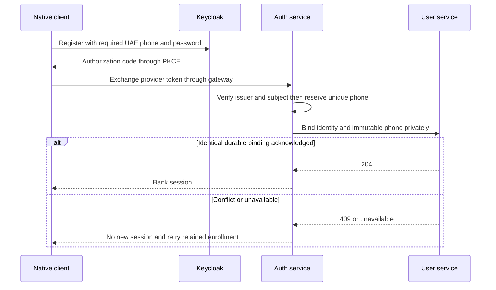

## Phone P2P and notifications

[HTTP contract](docs/p2p-contract.md) and [ADR 0014](docs/adr/0014-uae-registration-phone.md)
cover current phone admission and recipient eligibility. [ADR 0009](docs/adr/0009-phone-p2p-payments.md)
retains the durable payment design and optional local operator procedure.

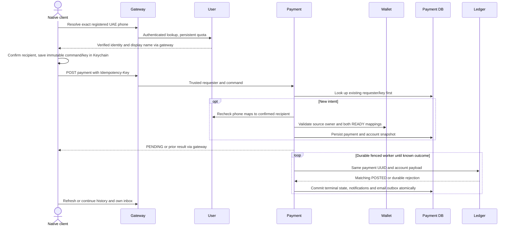

No shared distributed transaction is held across services. Ledger owns the money;
payment remains PENDING after timeout, malformed response or unavailable dependencies.
A crash after ledger commit is recovered by replaying the same ledger command. Terminal
notifications and email outbox events commit with payment state, with unique constraints preventing duplicate rows.
Email delivery is asynchronous and disabled by default. A separate worker resolves contact
through a private auth API and submits through fixed Mailtrap HTTPS endpoints or
Sandbox SMTP with required STARTTLS outside DB
transactions. Sandbox captures mail; real Sending requires verified contact. Durable
leases/backoff recover work, but provider acceptance followed by a lost acknowledgement
can produce duplicate email. Mail success is not a financial completion condition.
See [email operations](docs/email-notifications.md), [ADR 0015](docs/adr/0015-transactional-email-outbox.md)
and [SMTP transport ADR](docs/adr/0017-mailtrap-sandbox-smtp.md).

The recipient sees only completed incoming payments; the sender sees all its intents.
Legacy history and inbox endpoints return the latest 100 entries. Separate `/page`
endpoints provide owner-bound signed cursor pagination; Android uses load-more and
first-page refresh. Ordering uses immutable `(created_at, id)` keys, not offsets;
this is not a historical snapshot. See [pagination ADR](docs/adr/0018-cursor-pagination.md).

New registrations require a unique immutable UAE mobile number. Auth reserves it
across legacy and SSO identities, then idempotently binds it in user-service before
issuing a session. Keycloak requires the number as its username. Registration is not
ownership proof: claimed phones with a profile resolve even while phone_verified is
false. No SMS, push provider or external verification service is connected. Lookup
is exact and limited to 30 attempts per requester per 60 seconds, including misses.
It reveals the matched display name, not email or a user directory. Public phone
changes are disabled. Historical accepted payments remain readable and replayable.
See [ADR 0014](docs/adr/0014-uae-registration-phone.md) for enrollment failure recovery,
provider-account collisions and historical-user migration limits.

The native clients expose wallets, transfers, notifications and profile. Amounts use
exact Int64/Long minor units. An uncertain command/key is retained in device-only
Keychain (iOS) or Keystore-backed encrypted storage (Android), scoped per origin and
identity across restart/logout; retry uses the same payload. Foreground/manual refresh
fetches in-app notifications; no background delivery or OS push is promised.
Existing scaffold payment rows without recipient/account mappings are not executed or
exposed. See [M1](docs/m1.md) for acceptance and remaining scope.

## Agent team

Agents run for specific tasks inside Codex; they are not bank containers or permanent
background processes. The main chat acts as the orchestrator. Up to six subagents run
concurrently when the active session permits it; only roles needed for actionable work are activated. The primary orchestrator is separate. Prefer four implementers, QA and an independent reviewer; heavy build concurrency remains capped at two isolated CI slots.
Models/permissions are inherited from the session; instructions are not a security sandbox.

The optional local dispatcher runs a finite owner-approved manifest through
separate `codex exec` processes. SQLite persists claims, dependency stages,
attempts and reporting failures. Completion immediately schedules eligible work;
an empty or dependency-blocked queue exits without periodic GitHub polling.
Implementation, QA and review are independent assignments bound to the same Git
revision and source fingerprint. Only requests for changes with nonblank evidence
route back to the original owner within the manifest's retry budget. Dependency
and infrastructure blockers require operator action and preserve successful
implementations. Repository, role and usable-HEAD preflight rejects unsupported
assignments before consuming an attempt. Interrupted work retains its
leases. Optional pipeline identifiers isolate generations on the same issue;
prerequisites, evidence fences and remediation stay within that pipeline. Stale
change findings cannot invalidate a successful implementation. Interrupted work retains its
leases until an operator proves orphan processes stopped. Agent results never
establish merge, deployment or Done; those remain externally verified gates.
The runner filters credential environment variables and connector settings;
role file leases are coordination rules within each workspace sandbox.
See [dispatcher operations](docs/agents/dispatcher.md) and
[ADR 0023](docs/adr/0023-local-task-dispatcher.md).

The [local agent dashboard](docs/agents/dashboard.md) reads a sanitized queue
projection and timestamped native-agent observations on loopback only. It
distinguishes registered workers, confirmed activity and stale/unknown sources;
it cannot control workers or observe native agents continuously. See
[ADR 0028](docs/adr/0028-local-agent-dashboard.md).

Explicit operator archive annotations separate superseded attempts from current
counts while retaining their original queue states and history. They do not
resolve issues, mutate SQLite or approve work; invalid annotations hide nothing.

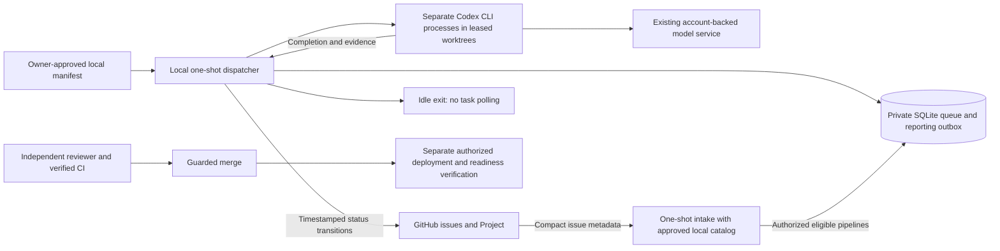

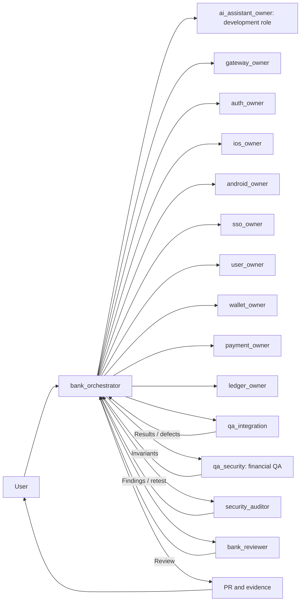

| Agent | Responsibility / writable scope |
| --- | --- |
| bank_orchestrator | Assignment, integration, shared config/runtime, Compose/CI, this documentation, PR |
| ai_assistant_owner | ai-assistant-service/** and tests: C# assistant, owned policy/index/provider adapters and constrained read tools |
| gateway_owner | app-gateway: routes, public contract, identity |
| auth_owner | auth-service: credentials, sessions, limits |
| android_owner | android: native Kotlin/Compose client, browser SSO, gateway contracts and secure recovery |
| ios_owner | ios: native SwiftUI client, gateway integration, browser authentication and tests |
| sso_owner | sso-service: Keycloak/OIDC configuration; auth SSO adapter files only under an explicitly transferred lease |
| user_owner | user-service: profiles, immutable phone claims, recipient lookup and attestation |
| wallet_owner | wallet-service: metadata/lifecycle, durable provisioning and live balances |
| payment_owner | payment-service: orchestration/idempotency, recovery, in-app notifications and email outbox/dispatcher |
| ledger_owner | ledger-service: accounts, balances, posting correctness |
| qa_integration | End-to-end contracts, outages/recovery; only assigned test files |
| qa_security | Financial invariants and owner isolation; only assigned tests |
| security_auditor | System security, trust, secrets, dependencies, Docker/CI; independent retesting |
| bank_reviewer | Independent review; read-only source with gated PR merge authorization |

Owners also maintain module tests and OpenAPI. QA/security are read-only until specific
test files are assigned. Each file has one writer; builds in a shared directory run
serially. The orchestrator manages shared Docker within the authorized task scope.

Roles: `.codex/agents`; skills: `.agents/skills`.

| Skill | Purpose |
| --- | --- |
| bank-java | Java 21, Gradle, layer boundaries, and resources |
| bank-postgres | jOOQ/HikariCP, Flyway, transactions/locks/retries |
| bank-api | OpenAPI, Javalin, identity, bounded HTTP |
| bank-android | Native Kotlin client, browser PKCE, Keystore persistence and emulator evidence |
| bank-ios | Native SwiftUI iOS 18+, gateway integration, Keychain and device validation |
| bank-sso | Keycloak OIDC, authorization code/PKCE, identity mapping and session migration |
| bank-testing | Spock, Testcontainers, ArchUnit, evidence |
| bank-financial-correctness | Postings, balances, concurrency, idempotency |
| bank-security | Security review and fix verification |
| bank-coordination | Assignments, messages, finding IDs, checkpoints |

Details: [skills matrix](docs/agents/skills.md), [workflow](docs/agents/workflow.md),
[team ADR](docs/adr/0006-agent-team.md). If automatic loading is unavailable, the role/skill
is read explicitly and passed into a scoped assignment; the fallback is disclosed to the user.

## Communication and remediation

Shared files do not imply shared conversation context. Saving Markdown does not notify
anyone by itself; the orchestrator forwards concrete assignments and evidence.

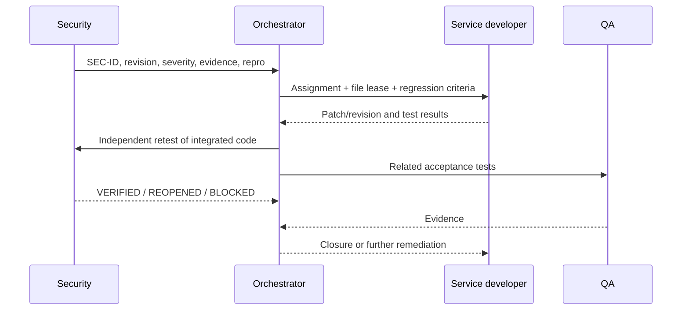

Use `send_message` for a running agent and `followup_task`, or the current client's
equivalent, for an agent that has finished. An unavailable agent is replaced with a new
one carrying the same IDs and context. On session resumption, assignments are restored
from the checkpoint and checked against source code/CI. These are orchestrator actions,
not a background task queue.

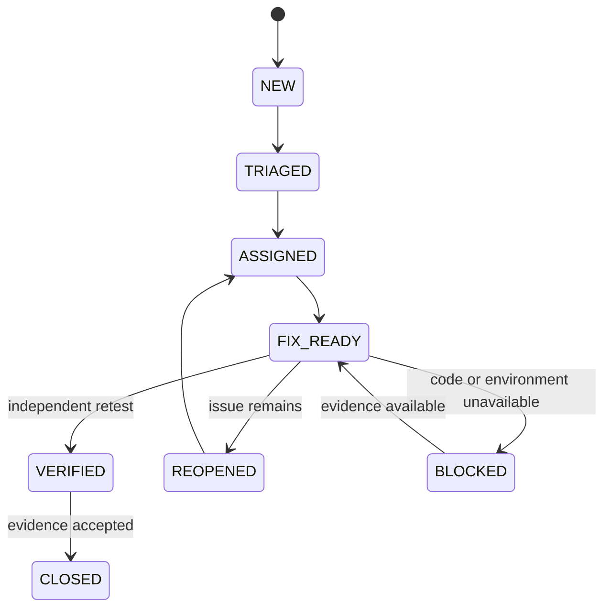

BLOCKED is possible at other stages, preserving the previous status and the reason.
False positives are closed with evidence and independent review. Confirmed unresolved
critical/high findings block PR readiness; green CI or the word "fixed" does not close
a finding. Accepting residual risk and merging are user decisions.
Records/checkpoints: [protocol](docs/agents/communication.md).

## Verification and delivery

All new PRs target `main`, which contains the integrated backend and native iOS/SSO
slices. Feature branches start from the latest main unless the user specifies
otherwise; the former bootstrap branch is no longer the default integration target. No direct pushes
to main. Independent reviewer merges follow [owner-authorized gates](docs/agents/merge-policy.md).

```mermaid
flowchart LR
    T["Task + contract"] --> DEV["Implementation"]
    DEV --> DOC["API / architecture / ADR"]
    DOC --> REV["Independent QA / security / review"]
    REV --> FIX["Fixes"]
    FIX --> CI["CI for the exact PR head"]
    CI --> TEST["Java / Spock / ArchUnit / PostgreSQL"]
    TEST --> SMOKE["Isolated Compose + smoke"]
    SMOKE --> READY["Reviewer merges after all gates pass"]
    CI --> ANDROID["Kotlin tests / lint / APK"]
    ANDROID --> READY
```

| Check | What it establishes |
| --- | --- |
| `./gradlew test` | Unit/architecture checks; excludes IntegrationSpec |
| `./gradlew check` | Also runs real PostgreSQL Testcontainers; requires Docker |
| `./gradlew installDist` | Runnable distributions |
| `scripts/smoke.py` | Readiness of six services, not business correctness |
| Auth/onboarding smoke in CI | Auth, profile, wallets through HTTP |
| Provisioning smoke in CI | Concurrent retries, ledger outage, wallet restart and unique zero-balance account mapping |
| Ledger smoke in CI | Private posting with synthetic funds |
| `scripts/p2p-smoke.py` in disposable CI | Phone resolution, public P2P, duplicate/concurrent spending, outages, post-commit recovery, notification isolation and journal reconciliation |
| Android CI | Debug APK, lint and JVM tests; emulator checks only on explicit owner request |
| SSO browser smoke in CI | Disposable Keycloak authorization code/PKCE and gateway exchange for iOS and Android |
| Kafka offline guards and snapshot fixtures | Isolation/parser gates and real Bash operations on synthetic files; no broker durability evidence |
| Separate Kafka CI acceptance job | Required isolated cluster publish/consume, ACL/TLS denial, outages, retained restart and cold restore; real-cluster execution remains pending |
| iOS validation | Paused by owner; existing script requires Mac/Xcode when resumed |

### Local build infrastructure

GitHub Actions schedules backend and Android work on disposable Linux Docker runners
labelled `armoney-local`. Up to two allowlisted slots run in separate Windows controller
processes. Each slot registers one job at a time, then removes that job's runner,
workspace and dedicated Docker daemon storage. Slot 1 preserves the original project
and mutex names; slot 2 has its own project, mutex, network and disposable volumes.
Same-slot contention and dirty-state checks fail before registration; cleanup targets
only the selected slot and exact runner registration. Artifacts persist in the shared
`armoney-ci-artifacts`. The application's running Docker stack is separate. PostgreSQL readiness probes use
TCP loopback to avoid accepting the temporary initialization server as ready.

```mermaid
flowchart LR
    GH["GitHub Actions: checks and scheduling"] --> R1["Slot 1: ephemeral Linux runner"]
    GH --> R2["Slot 2: ephemeral Linux runner"]
    H1["Windows controller 1: legacy mutex and project"] --> R1
    H2["Windows controller 2: separate mutex and project"] --> R2
    R1 --> D1["Slot 1 inner Docker daemon and workspace"]
    R2 --> D2["Slot 2 inner Docker daemon and workspace"]
    R1 --> A["Shared local artifact volume: reports and APK"]
    R2 --> A
    M["iOS development and CI paused by owner"]
    P["Persistent banking stack: not mounted in CI"]
```

The public repository requires approval for all external contributors before runner
registration. Approving untrusted workflow code is unsafe: privileged DinD is not a
hostile-code sandbox. Labels and workflow conditions are only additional checks.
The host administration token never enters the job; registration credentials are removed
before the runner accepts work. Failed isolation checks also prevent Docker cleanup.
Both slots repeat the trust audit before every registration. Shared host resources and
the writable artifact volume do not isolate mutually untrusted jobs. Current backend
and Android archive names are distinct within each run/attempt; future same-kind matrix
jobs require unique archive paths. Concurrency does not guarantee faster completion.

Android emulator instrumentation is excluded from routine CI and runs only on an explicit
owner request. The retained script uses software emulation on Docker Desktop without KVM. iOS
development and CI are paused by explicit owner instruction on 2026-10-12. Existing
source and test scripts remain; resumption requires Mac/Xcode. No iOS pass is claimed.
Operational steps and limitations: [local CI](infra/local-ci/README.md),
[ADR 0016](docs/adr/0016-local-ci-runners.md),
[ADR 0021](docs/adr/0021-local-ci-slots.md). Deployment remains an explicit owner action.

On Windows, use `.\gradlew.bat`. CI: [.github/workflows/ci.yml](.github/workflows/ci.yml).
Fixture funding and `down --volumes` are only for disposable CI environments, never user
databases. Smoke scripts currently expect port 8080 and the `arman-bank_bank` network;
a different Compose project name alone does not provide an isolated parallel test.

## Keeping documentation current

**Document owner: bank_orchestrator.** Every change is assessed for documentation impact.
Service owners report changes to APIs, schemas, connections, invariants, and limitations
in their handoffs. The orchestrator updates this file and related documents **in the same PR**;
bank_reviewer checks them against the integrated code.

| Change | Documentation to review |
| --- | --- |
| Service / HTTP dependency | Service map, responsibilities, sequence diagrams |
| API / auth | API table, OpenAPI, trust model |
| Migration / consistency | Data, ledger flow, ADR |
| Compose / env / ports | Runtime and instructions, without secrets |
| Agent / skill / communication | Team, skills matrix, protocol, role files |
| CI / tests / readiness | Checks, limitations, M1 plan |

If documented behavior is unchanged, the PR explains why documentation is unaffected
instead of making a cosmetic date change. A substantive update records the date and
verified source revision. Planned behavior must not be presented as implemented, and
completed features must not remain only in the future section. ADRs preserve history;
a new decision gets a new ADR. The independent reviewer treats documentation drift as a defect.

This is a rule for every task and review, **not a background update while Codex is closed**.
External changes are reconciled the next time work resumes on the repository. The rule
is established in [AGENTS.md](AGENTS.md), role instructions, and the PR template.
Further reading: [README](README.md), [IDEA and manual testing](docs/onboarding.md),
[ledger](docs/ledger.md), [M1](docs/m1.md), [ADRs](docs/adr/0001-bootstrap.md).

### Context-efficient agent routing

Dedicated ios_owner, android_owner and sso_owner roles own native clients and SSO.
They load bank-ios, bank-android and bank-sso skills only for relevant tasks. Shared instructions
remain in AGENTS.md/workflow; [context-map](docs/agents/context-map.md) points to
contracts on demand. [Audit](docs/agents/context-efficiency.md) records measured
text reductions, not estimated billing savings. Fresh scoped worker contexts and
bounded evidence replace full-history copies for independent tasks. iOS CI is paused;
disposable browser CI verifies Keycloak code/PKCE and SSO.

See [implemented features, deployment boundaries and agreed roadmap](docs/delivery-status.md) for current versus planned capabilities.

### Explicit synthetic local baseline

The local baseline tools use Keycloak administration for synthetic identity creation,
then the existing native PKCE and Gateway flows for profiles and wallet provisioning.
A separately opted-in Ledger CLI posts deterministic initial funds atomically through
the ledger journal; it adds no public funding endpoint. Its clearing account is reserved
for synthetic local funds. Manifests and database backups remain outside Git with
restricted permissions. Backup capture quiesces writers across owning primary databases;
replicas are rebuilt from primaries after restore. Tooling is not an automatic startup seed
and does not bypass email/phone verification requirements. Execution and restore evidence
are separate delivery gates. See [ADR 0019](docs/adr/0019-local-synthetic-baseline.md)
and [operations](docs/local-baseline.md).

## Banking assistant feature slice

[PR #46](https://github.com/aarbabaev/ArMoney/pull/46) merged after independent review and all required [CI #91 checks](https://github.com/aarbabaev/ArMoney/actions/runs/38387669495) passed on head `6a5bcfb6`. Local rollout of merged revision `ce5175bb` was verified on 2026-10-13; [issue #43](https://github.com/aarbabaev/ArMoney/issues/43) records the release checkpoint. This is dated deployment evidence, not a guarantee about future running containers. The [mission](docs/agents/missions/ai-assistant.md), [ADR 0020](docs/adr/0020-banking-ai-assistant-proposal.md), [HTTP/private trust contract](docs/ai-assistant-contract.md), [operations](docs/ai-assistant-operations.md) and [verified learning-outcome matrix](docs/ai-assistant-learning-outcomes.md) define scope and limits.

C#/.NET 10 is a service-local exception to Java 21. Domain/application/ports/adapters keep model, embedding, PostgreSQL and HTTP details outside the domain. ai-assistant-service owns only its separate PostgreSQL policy source/index, credentials and assistant-db volume. Operator ingestion is a separate local container/CLI; runtime has policy SELECT privileges only. No other service database or business classes are reused. Hybrid exact pgvector/full-text ranking is measured against a lexical baseline; active document/index versions, effective dates and provenance are retained. Initial documents are owner-approved demonstration rules from implemented ArMoney behavior, not legal/production bank policy.

```mermaid
flowchart LR
    A["Android Assistant tab: implemented, APK verified"] --> G["Gateway: authoritative session validation"]
    G -->|"Opaque active-turn read delegation"| S["C# assistant: bounded router and specialists"]
    S -->|"Fixed authenticated reads"| G
    G --> W["Wallet API"]
    G --> P["Payment history API"]
    W --> L["Ledger: balance authority"]
    S --> D[("Assistant PostgreSQL: policies and exact vector/full-text index")]
    I["Local operator ingestion CLI"] --> D
    S -->|"Minimal authorized context; external execution"| O["OpenAI model and embedding APIs"]
```

Gateway keeps the original bank bearer and internal bank key; assistant receives only a short-lived opaque read handle and independent directional credentials. Every fixed GET callback and final response revalidates the session; credentials alone cannot select an owner. No transfer/mutation, arbitrary URL/SQL/shell or ordinary-user upload tool exists. Gateway projects direction/status/amount/time and validates returned bank facts against its observed reads. Financial values use integer AED fils. Default last transaction is the first visible payment by created_at DESC, id DESC across own wallets; outgoing PENDING/COMPLETED/REJECTED and only COMPLETED incoming rows are visible. First-page history is bounded to 50; no complete monthly totals are promised.

The planner selects a finite policy intent; application code supplies fixed retrieval questions and filters relevant sections. Policy selection returns citation identifiers, never free-form answer prose. Application code renders exact demonstration source excerpts with document/version/section and explicit conflicting or insufficient evidence. Bank facts never enter model context. Prompts and documents are untrusted data; deterministic code validates tools, authorization and budgets. Runtime provider/embedding ports use external OpenAI despite local Docker hosting; owner authorized minimal egress. No personal server conversation is persisted; Android clears displayed turns on session change and rejects stale results. Provider store=false is not a zero-retention guarantee. The ai_assistant_owner configures a Codex developer, distinct from runtime assistant roles and containers. Local and required CI checks, measured model evaluation, independent review and local deployment readiness passed. Authenticated actual-provider acceptance ran in a matching disposable stack; no live-owner message or physical-device UX pass is claimed. See the versioned [learning-outcome evidence](docs/ai-assistant-learning-outcomes.md) for scope and limitations.

