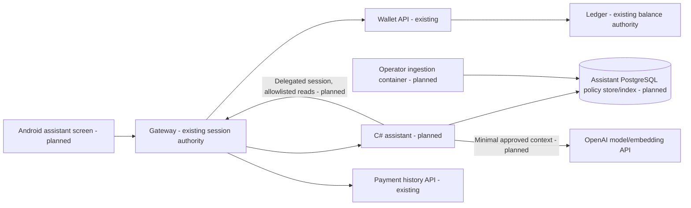

# ADR 0020: Proposed banking assistant boundary, retrieval and trust

Status: Accepted and implemented in PR #46. Required CI, independent review and
local rollout verified on 2026-10-13 at revision `ce5175bb`. This ADR retains the
original proposal context; measured evidence and limits are in the outcome matrix.
Related: [mission](../agents/missions/ai-assistant.md).

## Context and proposed decisions

Introduce `ai-assistant-service/` using C#/.NET 10 LTS as an intentional exception
to the Java 21 stack; other services and compatibility identifiers remain as they
are. [.NET lifecycle](https://learn.microsoft.com/en-us/lifecycle/products/microsoft-net-and-net-core)
lists .NET 10 support through November 2028. Pin supported SDK/runtime images
and compatible dependency versions at implementation, with restore/build evidence.
Use ASP.NET Core HTTP adapters, framework-free domain types and application ports
for providers, policy retrieval and bank reads; Npgsql parameterized persistence.
Existing Java jOOQ/Flyway rules do not imply C# business-class sharing. Versioned
SQL migrations are append-only after publication and need isolated upgrade tests.

Use the official C# client or documented REST adapter behind a provider port.
[OpenAI SDK documentation](https://developers.openai.com/api/docs/libraries)
documents the C# client; verify exact Responses/structured-output/embedding APIs
in the selected version before implementation. Python/TypeScript Agents SDKs are
not native C# dependencies. Implement bounded orchestration in C# rather than
depend on a visual Agent Builder product. Consult
[agent safety](https://developers.openai.com/api/docs/guides/agent-builder-safety)
for untrusted-context and structured-flow guidance. No hosted file-search index
replaces the required local document store.

## Planned data and runtime boundary

Assistant owns its DB, user/credentials and named persistent volume. It must not
query auth/wallet/payment/ledger databases or receive the global internal bank
service key. A private ingestion container has a separate migration/ingestion
credential; runtime receives least-privilege policy read access. No ordinary-user
upload or ingestion endpoint. Local containers host the service and index;
OpenAI execution remains external, as the owner explicitly approved.

## Trust contract to freeze before implementation

Gateway validates the opaque bank session on each protected message. Caller
identity/service headers are discarded. Assistant accepts only the dedicated
gateway credential plus authoritative session validation; requester cannot come
from JSON, retrieved documents, model arguments or a service credential alone.
Decision after independent design finding AI-SEC-DESIGN-01: retain the original
session only in gateway request-local memory. Issue a random short-lived opaque
read delegation handle bound to that session/owner, assistant audience and active
turn. Send the assistant only this handle and a direction-specific credential.
On each allowlisted read, resolve the handle and revalidate the retained session;
delete the handle when the turn ends or times out. Never expose the original
bearer to the assistant: it permits ordinary gateway mutations. The facade derives
owner from auth, not assistant-supplied owner IDs. No mutation forwarding or
arbitrary upstream path/URL. Credential possession alone cannot select an owner.
Expired/revoked/invalid sessions fail closed, including before returning an
in-flight personal answer. Independent security design review rejected bearer
forwarding; the frozen [contract](../ai-assistant-contract.md) uses opaque
delegation. Integrated tests must independently establish its implementation.

Session credentials never enter prompts, tracing or persistence. Minimize model
bank context to amount/currency/direction/status/time and necessary wallet facts;
exclude phone/email, internal identities, account identifiers and unrelated
history. Bind read facts server-side and render financial values deterministically
so generated text cannot overwrite money/status. No assistant transfer tools.

## Last transaction and provenance

Existing payment history orders immutable `created_at DESC, id DESC`; sender
sees PENDING/COMPLETED/REJECTED outgoing intents, recipient sees only COMPLETED
incoming payments. Default "last transaction" means the first visible payment
across the authenticated owner's wallets, ordered by creation, not completion or
`updated_at`. Display creation time, direction and actual status, with a UTC
instant and Asia/Dubai display. Explicit "last completed" needs a bounded filtered
search and an honest window limit if exhausted. Latest main also has signed,
owner-bound cursor pagination; the stale local snapshot has only legacy lists.
Wallet-specific filtering cannot silently claim completeness from a partial page.
Freeze paging/window limits in the implementation contract. AED is integer fils.
Facts carry source and fetch time, and are separate from policy citations. Empty
history returns an empty-history state; outage returns unavailable, never a
fictional transaction, balance zero or completed payment.

## Ingestion, retrieval and versioning

Initial formats: UTF-8 Markdown and plain text, at most 1 MiB/document; no PDF,
remote fetch, archives, HTML execution or arbitrary parsing tools. Operator uses
an explicitly authorized local ingestion command/container with a read-only
document mount and ingestion DB credential; ordinary bank session is insufficient.
Owner selected demonstration rules based on implemented ArMoney behavior for
the initial launch. Label every document and answer citation as demonstration
policy with source revision/provenance; these are not production/legal bank rules.
Test fixtures remain separate from the approved demonstration corpus. A future
real policy corpus requires explicit document approval, not invented bank rules.

Persist source content plus logical document ID, version, section/chunk ID,
provenance, SHA-256 digest, effective-from/to, superseded version, and active index
version. Normalize and chunk by headings with bounded overlap; prevent a chunk
from losing its effective-date/version metadata. Same document/version/digest
reingests idempotently; same version with a different digest is a conflict.
Stage parsing/embedding outside activation transactions. Atomically activate only
a complete validated index; failed staging leaves the prior version readable.
Rollback switches the active version, never rewrites a published document.
Credentials and manifests contain no document bodies in general logs.

Evaluate PostgreSQL full-text ranking versus full-text plus pgvector exact vector
distance and reciprocal-rank fusion. Full text is a simple lexical baseline;
vectors can help paraphrases but add embedding cost, dimension/model compatibility
and operational dependencies. Start with exact vector ranking on a bounded local
corpus; do not add an approximate index without measured need/recall evidence.
Pin embedding model/dimension, normalization/chunker version and index version.
Filter effective/active documents before ranking; conflicts yield explicit
conflicting-evidence responses instead of arbitrary policy selection.

## Bounded Agentic RAG

Router delegates typed requests to policy and bank-read specialists, implemented
as in-process application use cases. Shared budget covers every handoff and call:
proposed maximum four steps, two retrieval refinements, six chunks/6,000 context
characters, 2,000 question characters, 1,000 output tokens and 30 seconds overall.
Before provider calls enforce a configured request/cost ceiling using pinned
model prices and token upper bounds; unknown pricing fails budget configuration.
Validate every tool name/argument with an allowlist and fixed schema outside the
model; no requester argument. Bound concurrency and per-owner request rate,
responses and cancellation. Untrusted retrieved text remains data and never
changes tools/system instructions. No SQL, shell, external URL or payment tools.

The planner selects finite policy intents; application code supplies fixed
retrieval questions and relevant-section filters. Policy selection returns only
verified citation IDs/outcomes/refinement, never free answer prose. Application
code renders exact source excerpts with a demonstration label; invalid or absent
evidence yields insufficient evidence. Independent synthetic evaluation grades
relevance as well as source support. Conflicting/expired policies are explicit.
Bank facts are rendered from typed API results, not generated numbers. Proposed
message response contains answer, policy citations, bank facts/provenance and
bounded outcome status; exact OpenAPI is frozen in the next step.

## Privacy and failure operations

No server-persisted personal conversation history initially; each message is
request-local. Android clears displayed chat on logout/identity/origin change and
rejects stale asynchronous results. If persistence is later required, add an
owner-scoped retention/deletion ADR first. Provider requests use `store=false`
where supported; it does not promise zero provider retention. Document provider
retention/account controls from current official docs and actual account setup.
No secrets, full personal questions, bank bodies or policy excerpts in logs.
Safe diagnostics: request ID, outcome class, elapsed time and aggregate usage.
Provider errors/timeouts yield graceful unavailable responses; no unbounded retry.
Readiness distinguishes DB/index/configuration readiness from actual model
evaluation/provider access. Health success is not an answer-quality test.

## Consequences and delivery gates

The C# exception adds a second build/runtime and isolated migrations; maintain
clear boundaries and separate CI checks. Independent QA/security/reviewer must
verify owner/session isolation, spoofed headers/arguments, injection, ingestion,
citation grounding, ordering/empty history, budget cancellation and failures.
See the [measurable outcome matrix](../ai-assistant-learning-outcomes.md).
Run .NET checks, full Java check, Android checks and disposable Compose smoke.
Report actual provider evaluation separately from mocks; missing model/key/corpus
or CI/deployment evidence remains blocked, not a completed feature.
