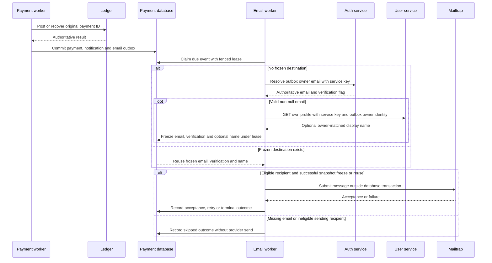

# Transactional email notifications

Payment-service owns the email outbox and its background dispatcher. A terminal
payment, in-app notification and email event commit together. Mailtrap outages
cannot turn a completed transfer into a rejection or remove its in-app message.



## Events and recipients

| Event | Recipient |
| --- | --- |
| PAYMENT_COMPLETED | Sender |
| PAYMENT_RECEIVED | Recipient of a completed transfer |
| PAYMENT_REJECTED | Sender only |

Messages contain the event, payment ID and exact AED amount. They do not expose the
counterparty's email or full phone number. Only newly completed/rejected payments
enqueue email; migration does not email historical transactions. Existing in-app
notification APIs and mobile screens are unchanged.

Messages use equivalent HTML/plain text content. An optional owner profile display
name personalizes the greeting; missing or invalid names use `Hello,`. This is
user-supplied presentation data, not a verified legal or full name. HTML text is
escaped, and no external images, tracking pixels or remote fonts are included.

## Configure Mailtrap

Keep credentials in your ignored local `.env`, never in source, screenshots or
logs. Only payment-service receives Mailtrap delivery credentials.

### Sandbox SMTP

Select SMTP to use the username/password from your Sandbox inbox SMTP Integration
page. API tokens and inbox IDs are not required for this transport.

```dotenv
EMAIL_DELIVERY_ENABLED=true
MAILTRAP_MODE=sandbox
MAILTRAP_TRANSPORT=smtp
MAILTRAP_SMTP_HOST=sandbox.smtp.mailtrap.io
MAILTRAP_SMTP_PORT=2525
MAILTRAP_SMTP_USERNAME=<Sandbox SMTP username>
MAILTRAP_SMTP_PASSWORD=<Sandbox SMTP password>
MAILTRAP_FROM_EMAIL=notifications@example.com
MAILTRAP_FROM_NAME=ArMoney
```

SMTP is restricted to the Sandbox hostname and STARTTLS ports 25, 587 or 2525.
STARTTLS, certificate validation and hostname verification are mandatory before
authentication. Port 465 (implicit TLS) and real Sending over SMTP are not supported.
No arbitrary SMTP host or TLS bypass is exposed. SMTP acceptance still means provider
acceptance, not mailbox delivery; ambiguous connection failures can produce duplicates.
The same durable outbox, frozen recipient/mode and retry limits apply.

### HTTP API (existing transport)

`MAILTRAP_TRANSPORT=api` is the default for existing installations.

```dotenv
EMAIL_DELIVERY_ENABLED=true
MAILTRAP_MODE=sandbox
MAILTRAP_TRANSPORT=api
MAILTRAP_API_TOKEN=<Mailtrap API token>
MAILTRAP_INBOX_ID=<numeric Sandbox inbox ID>
MAILTRAP_FROM_EMAIL=notifications@example.com
MAILTRAP_FROM_NAME=ArMoney
```

Sandbox captures mail in Mailtrap rather than delivering it to recipients. Obtain
the token and inbox ID from your Sandbox API integration page. For real delivery,
use `MAILTRAP_MODE=sending`, an Email Sending API token and an approved sender on a
Mailtrap-verified sending domain. The inbox ID is then unused. No arbitrary provider
endpoint or TLS bypass is configurable. See the official
[Mailtrap API documentation](https://docs.mailtrap.io/developers).

Compose sets `AUTH_BASE_URL=http://auth-service:8080`. For a local IDEA launch,
configure the auth origin and internal service key alongside the payment database.
Deploy auth-service before enabling the dispatcher. Recreate payment-service with
the same complete Compose file list used by your installation to load changed
environment variables; a container restart alone does not update its environment.

With delivery disabled, events remain queued. Enabling delivery can send that
backlog, including events created while credentials were unavailable. Inspect it
before switching from Sandbox to real Sending. Do not clear financial records or
modify terminal payment states to retry an email.

## Contact trust

The private auth endpoint `/v1/internal/identities/{id}/email` requires the internal
service key and is not exposed through gateway. Local password registration emails
are unverified. For SSO, validated introspection refreshes a separate email contact
and its verification flag; it does not change login credentials or link accounts.
Missing claims clear stale provider contact on the next successful exchange.
Existing SSO users need to sign in again before a contact can be captured.

Sandbox can use an unverified address because it does not deliver to it. Real
Sending skips unverified or missing addresses. Email verification enrolment is
not implemented here; do not fabricate verification to enable real delivery.
Provider contact changes are observed at SSO exchange, not continuously. A selected
destination is frozen for retries; operators must account for that snapshot when
handling address revocation and delayed delivery.

For personalization, payment-service calls `USER_BASE_URL` + `/v1/users/me` with
`X-Service-Key` and `X-Identity-Id` from the claimed outbox owner. Auth remains
authoritative for the email address; profile contact fields cannot redirect mail.
The profile must match the requested owner and provide a nonempty stripped name
of at most 100 Unicode code points without ISO control characters. The request
timeout is 3 seconds. Unavailable or invalid profile data yields a neutral greeting;
interruption propagates. The email, verification and optional name, including a
null fallback, freeze together before send and remain unchanged on retries.
Existing names are not backfilled. SMTP/API calls occur outside database
transactions; provider acceptance does not determine the financial outcome.

## Recorded payment styling rollout

The [October 15 rollout checkpoint](https://github.com/aarbabaev/ArMoney/issues/47#issuecomment-6191496123)
records deployed payment styling merge
`6ab2bddb34d16832103fc757febcaf422d733d33`, successful V5 migration and preserved
existing financial data. One sandbox notice was SMTP-accepted; another became
`DEAD/provider_rejected` after attempt 1. Its original cause remains UNKNOWN.
The [later reviewer checkpoint](https://github.com/aarbabaev/ArMoney/issues/47#issuecomment-6192770636)
records receipt-backed diagnostic deployment
`a3be1ed1de7f69ce08b756d02b83e70ba8a9094e` with readiness HTTP 200 and preserved
rows/environment, without new financial/mail probes or historical requeue.
These are recorded operator/reviewer receipts, not a fresh live verification.
SMTP acceptance does not confirm mailbox rendering. Confirmed rendering and
separate auth login/registration styling acceptance remain outstanding in that
checkpoint; issue47 is not completed by the payment rollout.

## Reliability and operational limits

Network calls never hold a payment database transaction. Expired leases allow
recovery after restart; stale workers cannot acknowledge another worker's claim.
Transient errors use bounded backoff. Permanent failures and exhausted attempts
remain inspectable rather than disappearing. Stored error codes contain no provider
body, token or full recipient address.

A successful provider response records acceptance, not proof that the user's
mailbox received the email. A lost response or process crash after provider
acceptance can cause duplicate emails on retry. Event uniqueness prevents duplicate
outbox rows but cannot provide exactly-once delivery across PostgreSQL and Mailtrap.
There are no delivery webhooks, bounce processing or automatic retention in this
slice. Never run financial funding fixtures against a persistent installation.

Inspect delivery status in payment-db without listing recipient addresses:

```sql
SELECT status, error_code, count(*)
FROM email_outbox
GROUP BY status, error_code
ORDER BY status, error_code;

SELECT count(*) AS due_events, min(created_at) AS oldest_event
FROM email_outbox
WHERE status = 'PENDING' AND next_attempt_at <= clock_timestamp();
```

`SENT` means provider acceptance; `SKIPPED` records an ineligible recipient;
`DEAD` records a permanent error or exhausted retries. The dispatcher does not
silently requeue terminal rows. Correct configuration/contact failures before
considering an operator-reviewed replay, and consider possible prior acceptance.
There is no public retry/admin API. Do not print outbox rows containing addresses
into logs or issue descriptions. A row's delivery mode is pinned when first claimed;
switching configuration must not turn an existing Sandbox retry into real mail.

## Registration verification presentation

The Auth registration verification email renderer supplies a plain-text part followed by an HTML alternative using the existing Mailtrap Sandbox SMTP transport. It accepts only a six-digit code and uses a generic greeting; it does not infer a profile or legal name before identity verification. SMS content is unchanged. This source change retains the existing default-off delivery gate. Sixty focused renderer/transport/SMTP tests and thirteen isolated SMTP/TLS/PostgreSQL acceptance tests passed. Full Auth checks, exact-head CI and runtime/mailbox rendering remain unverified, and it does not add or activate login notification persistence or workers.
