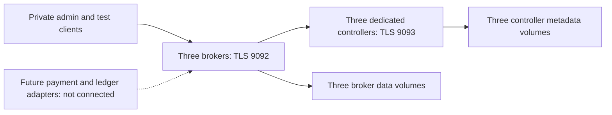

# Local Kafka operations

This optional infrastructure is defined in source for #31. It does not connect
payment/ledger services, implement the Saga, or establish a deployed/verified
cluster. Runtime acceptance evidence belongs to the exact integrated revision.
The [Saga contract](kafka-saga-contract.md) defines the proposed business messages;
#32 implements producers, consumers and PostgreSQL outbox/inbox recovery.

## Topology and pinned software

`compose.kafka.yaml` runs three dedicated KRaft controllers (node IDs 1-3) and
three brokers (101-103), each with a separate project-scoped data volume. It uses
the official `apache/kafka:4.3.1` multi-platform manifest:

```text
sha256:77e3df9054047a88b520d0cc46e16696d3b22022e1d580aeccd2632df6532837
```

The tag/digest was checked through the [Apache image registry](https://hub.docker.com/r/apache/kafka/tags?name=4.3.1)
on 2026-10-14; amd64 manifest is
`sha256:ccd1314e47ec76909e01f86308b4dcf2064f19f7c89759234322314b0e319e26`.
A digest pin prevents accidental tag drift; it is not a vulnerability scan.
Review release/security updates and repeat the failure suite before changing it.

Controllers use a dynamic quorum with three initial voters. Two controllers
must remain available. Dedicated roles let tests lose two brokers while keeping
metadata quorum available, so minimum-ISR refusal can be tested independently.
Kafka's [KRaft guide](https://kafka.apache.org/43/operations/kraft/) describes
quorum membership and explicit storage formatting.



There are no host-published ports, external networks or banking database mounts.
All traffic stays on the Compose project's internal network. The existing bank
project/volume identifiers are unchanged. Same-host containers do not survive
host/storage failure and are not host-level high availability.

The configured limits total 6.75 GiB for six nodes: controllers have 256 MiB JVM
heaps/768 MiB container limits; brokers have 512 MiB heaps/1536 MiB limits.
Each node has a one-CPU ceiling. Allow at least 8 GiB free memory for this cluster
and short-lived tools, plus the existing banking stack's needs. These are initial
local limits, not measured throughput or production sizing. Disk consumption is
workload-dependent; seven-day retention is not a disk-capacity limit. Monitor
free space and reserve additional room for replication/recovery.

## Authentication and storage boundaries

Mutual TLS is mandatory on broker and controller listeners. Certificates use
hostname verification; no plaintext listener is enabled. StandardAuthorizer
defaults to deny. Node principals and the private admin principal are superusers;
application principals are not. A compromised node/admin key is a cluster-wide
security incident. CA signing material is not mounted into any container.

| Principal | Granted application access |
| --- | --- |
| payment | Write commands and payment outcomes; read ledger results using group `payment-ledger-result-v1`; cluster IdempotentWrite. |
| ledger | Read commands using group `ledger-transfer-v1`; write ledger results; cluster IdempotentWrite. |
| denied | No ACLs; negative-test identity only. |
| admin | Explicit provisioning/diagnostics; never distributed to applications. |

Controllers still require authenticated and authorized requests; being on the
internal network grants no admin permission. The source includes no passwords,
private certificates, broker credentials or production data. Each container
mounts only its own credential directory, read-only. Containers run as uid/gid
1000 with dropped capabilities, a read-only root filesystem and bounded tmpfs.

## Initial local setup

Only the orchestrator operates the owner's persistent stack. These steps describe
a separately authorized Kafka setup, not permission to deploy from a worker.
Use Linux/WSL with Docker Compose, Bash, GNU coreutils and JDK `keytool`.
Run from the repository root. Credential generation requires uid 1000 or root;
root assigns generated files to the pinned image's uid/gid 1000.
The Kafka image contains a Java 21 JRE, not a supported credential-generation
JDK environment. If host `keytool` is unavailable, run generation inside the
isolated CI JDK environment, or a separately selected JDK container with Bash
and GNU coreutils. Mount the checkout read-only at `/work` and an existing
external private parent directory writable at `/private`; run as root with no
network and execute `bash /work/infra/kafka/generate-local-credentials.sh
/private/credentials`. Set `KAFKA_SECRETS_DIR` to the resulting directory's
absolute path visible to the Docker daemon. Do not assume a host path is visible
inside the inner daemon: its credential bind sources must exist in that daemon's
filesystem. Credential generation itself never contacts Kafka or Docker.

Choose a stable, new project and an absolute credential path **outside every
source checkout and Docker build context**. The generator refuses an existing
destination or a path inside this checkout. Keep the same project, credentials
and cluster ID on later starts. Generate credentials once:

```bash
export KAFKA_SECRETS_DIR=/absolute/private/armoney-kafka-credentials
bash infra/kafka/generate-local-credentials.sh "$KAFKA_SECRETS_DIR"
project=armoney-kafka-local
docker compose -p "$project" -f compose.kafka.yaml config --quiet
for node in kafka-controller-{1,2,3} kafka-broker-{1,2,3}; do
  docker compose -p "$project" -f compose.kafka.yaml run --rm --no-deps "$node" bash /opt/armoney/format.sh
done
docker compose -p "$project" -f compose.kafka.yaml up -d --wait --wait-timeout 240
docker compose -p "$project" -f compose.kafka.yaml run --rm kafka-init
KAFKA_CLIENT_PRINCIPAL=admin docker compose -p "$project" -f compose.kafka.yaml run --rm kafka-client bash /opt/armoney/client.sh topics
```

Generation stores the cluster ID, initial voter directory IDs and CA in the
external directory. Certificates expire after 90 days; the CA expires after ten
years. Protect the full directory and an encrypted backup. Copy individual
application credential directories only to their intended workload. Never commit,
upload in CI reports, print, or include this directory in a build context.

Formatting is an explicit action. `format.sh` accepts an already formatted volume
only if cluster/node identity matches, and refuses unrecognized nonempty data.
The pinned image seeds a new volume root as uid 1000, gid 0. Explicit formatting
or verified cold restore may change only a real, empty root from gid 0 to gid
1000, while retaining uid 1000. The shared preparation helper accepts only the
fixed data/restore paths, checks directory inspection succeeded, and never
recurses or changes existing/nonempty storage. Snapshot ownership checks remain
uid/gid 1000:1000; this is not an ownership-repair procedure for existing data.
Normal startup never formats; missing/mismatched `meta.properties` fails closed.
Do not run format against an unexpectedly empty prior volume. Investigate lost
mounts/data first; formatting cannot recover a missing metadata quorum.

For ordinary restart, use `up -d --wait` with the same project and external
credentials; do not regenerate credentials or cluster IDs. Shutdown uses
`docker compose -p "$project" -f compose.kafka.yaml stop`. Never remove persistent
volumes as a restart/upgrade procedure. Kafka image-declared unused paths are
covered by tmpfs, avoiding anonymous credential/config volumes.

## Topics and tools

Explicit initialization creates the three v1 contract topics with three
partitions, replication factor 3, minimum ISR 2, seven-day delete retention and
32 KiB record limits (the application envelope limit remains 16 KiB).
Payment UUID is the key; changing partitions requires an ordering/replay review.
Unclean leader election and automatic topic creation are disabled. Initialization
verifies existing topic settings and refuses drift rather than silently altering
them. Inspect existing ACLs before onboarding additional principals.

Internal offset/transaction state topics also use replication factor 3;
transaction state minimum ISR is 2. Clients explicitly enable idempotence,
`acks=all` and compatible retries/in-flight limits. A successful broker ack is
not proof of a PostgreSQL commit or email delivery. See [Kafka producer settings](https://kafka.apache.org/43/configuration/producer-configs/)
and [authorization](https://kafka.apache.org/43/security/authorization-and-acls/).

The tools-profile service `kafka-client` mounts `KAFKA_CLIENT_PRINCIPAL`
(default `denied`). It exposes these bounded CLI wrappers:

```text
bash /opt/armoney/client.sh produce TOPIC
bash /opt/armoney/client.sh consume TOPIC GROUP MAX_MESSAGES TIMEOUT_MS
bash /opt/armoney/client.sh topics
bash /opt/armoney/client.sh quorum
```

Produce reads one `payment-uuid:JSON` record per line on stdin; consume prints
`key:value`. Use synthetic messages only until the real adapter contract is
implemented. Admin Kafka tools are under `/opt/kafka/bin`; credentials are
`/run/kafka-secrets/client.properties`. Wrapper execution via Compose is
`run --rm -T kafka-client bash /opt/armoney/client.sh ...`.
Console tooling is a transport fixture, not a financial handler or schema validator.
Consumer automatic offset commits are disabled; no application exactly-once claim
is made. The wrapper sets `--sync`, so each send waits for its acknowledgement
and failures cause a nonzero process exit. Assert acknowledged consumption and
inspect timeout/error outcomes in the independent smoke test; a broker
acknowledgement alone cannot establish application processing.

## Readiness, metrics and alerts (#22)

Node health checks use authenticated Kafka protocol requests, not open TCP ports.
Controller health checks metadata quorum; broker health checks API availability.
These checks do not establish every topic's replication health. Before enabling
traffic, describe topics and verify three replicas, all three ISR members and
an elected leader for every partition. After one node failure, ISR=2 allows
publication; ISR below 2 must refuse acknowledged writes.

Use the admin tool container for local observations (never expose JMX/admin
ports publicly):

* `kafka-metadata-quorum.sh --bootstrap-server kafka-broker-1:9092 --command-config /run/kafka-secrets/client.properties describe --status`:
  leader, voter membership, committed high-watermark and follower lag.
* `kafka-topics.sh --bootstrap-server kafka-broker-1:9092 --command-config /run/kafka-secrets/client.properties --describe`:
  offline leaders and under-replicated/under-minimum-ISR partitions.
* `kafka-consumer-groups.sh --bootstrap-server kafka-broker-1:9092 --command-config /run/kafka-secrets/client.properties --describe --all-groups`:
  lag and inactive groups. Missing business consumers are expected before #32.
* Container status/restarts, volume filesystem free bytes and `docker stats`:
  process/storage pressure. Do not include environment/config dumps in reports.

Alert on unavailable quorum or partitions immediately; minimum ISR below 2 stops
safe publication. Under-replication lasting over 60 seconds requires investigation.
Initial disk warning/critical thresholds are 20%/10% free. Plan capacity before
reaching them; never delete ledger data or broker logs manually to silence alerts.
Warn at 14 days to certificate expiry. For enabled consumers, sustained growing
lag or inactivity beyond their recovery SLA needs the owning service's runbook.
These are documented operator checks/thresholds, not an installed monitoring
daemon or external alerting provider. #22 owns scheduled metrics and notifications.

## Backup and storage recovery (#21)

Broker replication is not backup. Protect the cluster ID, voter directory IDs,
certificates/CA, ACL/topic configuration and all six data volumes. Do not
assume a live file copy across independent volumes is a consistent snapshot.

For an isolated recovery rehearsal, quiesce publishers/consumers, record topic
end offsets and acknowledged synthetic IDs, stop all six nodes, and take a
coordinated cold copy of all data volumes plus the external credential directory.
Record image digest, volume-to-node mapping, cluster ID, snapshot time and
acknowledged watermark without secret values. Encrypt snapshots, restrict access,
and restore only to a new isolated project with matching node identities.
Measure elapsed recovery time and compare consumed IDs/offsets with the captured
watermark for the recovery point. No measured RTO/RPO is claimed until exercised.

`infra/kafka/snapshot.sh` provides a cold **directory bundle**, requiring no tar
implementation. Run it with the same pinned Kafka image as the nodes, uid/gid
1000, `--network none`, `--read-only`, `--cap-drop ALL`,
`--security-opt no-new-privileges:true`, and a private writable `/tmp` tmpfs.
Mount `infra/kafka` read-only at `/opt/armoney`. The isolated acceptance runner
must validate the daemon, project labels and exact volume ownership, and prove
all six source nodes stopped **before each copy**. The helper has no Docker
socket and cannot itself establish that the nodes are stopped.

```text
# /source: exact validated node volume, read-only
# /archive: external private directory visible to the inner daemon, writable
bash /opt/armoney/snapshot.sh archive NODE CLUSTER_ID

# /archive: same external snapshot directory, read-only
# /target: empty validated volume belonging to a separate restore project, writable
bash /opt/armoney/snapshot.sh restore NODE CLUSTER_ID MANIFEST_SHA256
```

`NODE` is exactly one of `kafka-controller-1` through `kafka-controller-3` or
`kafka-broker-1` through `kafka-broker-3`. The archive command creates
`/archive/NODE/{data,manifest,checksums}` and prints its manifest SHA-256.
Retain all six hashes in the trusted caller's recovery inventory, outside the
bundles; pass the expected hash to restore rather than deriving it from a bundle
being restored. Manifests bind cluster ID, node ID, entry count and the checksum
inventory, including directory entries. Restore checks the exact inventory and
every file checksum before copying, verifies the copied data, and prints
`RESTORE_VERIFIED` on success.

Both operations reject symlinks, hard links, special files, unsafe names and
unexpected ownership. Existing bundles and nonempty restore targets are refused.
Cluster and node identity keys must each occur exactly once in canonical
metadata. Escaped properties and conflicting duplicate keys are refused.
Manifest and checksum files also require single-link ownership by uid/gid 1000.
The external archive directory must remain private and must not be modified
concurrently. A failed archive/restore may leave a partial destination; preserve
it for diagnosis and use a fresh destination for retry. The helper never deletes
source data or partially restored targets. It snapshots node storage only;
credentials, captured offsets and the six-node stopped-state evidence remain
separate required recovery inputs. QA bounds helper execution and cleanup to
its validated disposable projects; these commands do not authorize live-stack
backup, volume adoption or deletion.

A single failed broker can recover from surviving replicas; preserve its metadata
identity and inspect ISR catch-up before considering recovery complete. Replacing
lost broker storage is an explicit incident action performed only with a healthy
controller quorum and surviving acknowledged data. Never reformat controllers
or invent a new cluster ID to make a broken deployment start.

Loss of controller quorum/storage or all broker copies requires a validated
coordinated restore or controlled cluster rebuild. Keep future financial
dispatch fenced while authoritative PostgreSQL/outbox/inbox reconciliation
determines what may be replayed. Restoring a broker alone does not restore lost
database state. No broker backup can promise zero financial loss if authoritative
databases and backups have lost acknowledged commits; follow the Saga incident
gate. The orchestration/outbox recovery implementation remains #32.

Certificate renewal must retain the existing cluster/voter manifests and service
principal names. Generate/validate replacement leaf certificates against the
retained CA, then roll one node at a time while monitoring quorum/ISR. The initial
generator deliberately refuses to overwrite credentials; it is not a renewal
tool. CA rotation, automated backup and automatic disaster recovery are not
implemented here. #21 must provide independently exercised backup/restore procedures before
claiming disaster-recovery readiness.

## Disposable acceptance and delivery

Independent QA owns `scripts/kafka-smoke.py` and its guard tests. Expected
invocation is `python3 scripts/kafka-smoke.py --project armoney-kafka-test-<32hex>`.
Before Docker mutations it must require the repository's dedicated inner daemon,
disposable CI marker and safe workspace, use a fresh external credential
directory, and reject local environment/Compose overrides. Existing backend
checks remain required; this is additional infrastructure coverage.

The separate `kafka` CI job first runs the local-CI guard suite, Kafka smoke
guards, real Bash snapshot fixtures and shell syntax checks, then verifies the
dedicated inner daemon before running one fresh UUID-project smoke test.
The snapshot fixtures exercise synthetic files without contacting Docker;
they do not establish broker durability, cluster recovery time or recovery point.
Real-cluster acceptance and deployment verification remain unrun until the
isolated CI job completes on the integrated revision. No RTO/RPO or readiness
result is inferred from source review or the offline test suites.

Required cases: authenticated publish/consume; invalid/missing client credentials;
denied principal and cross-service ACL rejection; exact topic configuration;
restart with retained records; one-broker failure; two-broker insufficient-ISR
refusal while three controllers remain running; broker recovery/ISR catch-up;
missing or mismatched storage identity refusal; and isolated cold storage restore
with measured recovery evidence. Test controllers separately so broker ISR
failure is not confused with quorum failure.

Cleanup may remove volumes only for a validated disposable project created by
that test in the isolated daemon. Never use the local persistent project,
implicit Compose files, host Docker socket or CI funding fixtures on user data.
Capture bounded diagnostics without credentials or message bodies containing
personal data. A failed or unrun case remains explicitly blocked. Deployment and
runtime verification are separate from source completion.

## Assigned #32 persistence scope checkpoint (proposal, not implemented)

The orchestrator's scope decision assigns #31 broker infrastructure, security and
isolated runtime checks, matching the issue's acceptance. #32 owns service-local
outbox/inbox primitives, migrations, adapters and atomic business integration,
as recorded in ADR 0022 and the Saga contract's migration step. The following
concrete primitive slice is a proposed breakdown for #32's exact file assignments;
no persistence schema, Java helper or financial adapter described here is
implemented by this infrastructure revision.

**Ownership and dependency order:** payment-owner owns payment-service tables,
helpers and PostgreSQL integration tests; ledger-owner owns the corresponding
ledger-service paths. The orchestrator owns the enabling ADR, build/CI and map.
Independent financial QA and the security auditor review both integrated slices.
No service queries a peer database and platform-runtime acquires no business
types. Verify the latest published Flyway versions before assigning append-only
migrations; the inspected baseline ends at payment V4 and ledger V3.

1. Freeze per-service row/transaction contracts and retention constraints. Add
   service-owned `message_outbox` and `message_inbox` tables, leaving current HTTP
   payment/ledger execution and email delivery unchanged. Do not backfill
   historical payments or start a broker relay in this primitive slice.
2. Implement small per-service infrastructure helpers accepting the owning
   transaction's jOOQ `DSLContext`. Proposed operations are `appendOutbox`,
   `recordInbox`, `claimOutbox`, `ackOutbox` and `retryOutbox`. They never open an
   independent transaction when composing business changes. Claim/ack/retry
   adapters own short local transactions with no network I/O. Introduce
   application ports only with a real relay/consumer use case; avoid unused
   shared layers and service-to-service imports.
3. Verify the primitives against real PostgreSQL/Flyway with concurrent callers,
   rollback and restart fixtures, then independently review them. #32 must
   compose these rows with admission, ledger posting and payment terminal state
   in each owning local transaction before enabling any Kafka cohort.

Proposed outbox row: `event_id` UUID primary key, stable `payment_id`, bounded
topic/key/type/version routing fields, immutable UTF-8 event bytes (1-16 KiB),
32-byte SHA-256 payload hash and creation timestamp. Keep mutable attempts,
`next_attempt_at`, UUID lease token/expiry, acknowledged timestamp and bounded
error code separate. Add an index for due unacknowledged rows and constraints
for paired lease fields and nonnegative attempts. Trigger-protect immutable
identity, routing and payload fields. Validate bytes/hash using the JDK; avoid
requiring a new PostgreSQL extension. Same event ID and identical bytes/routing
is a duplicate; changed bytes/routing is a conflict, never an overwrite.

Proposed inbox row: primary key `(logical_handler, event_id)`, stable payment ID,
32-byte payload hash, committed disposition and timestamp. Compare the existing
row under concurrent insertion before accepting a duplicate; identical identity
and hash is a no-op, mismatched identity/hash is an integrity conflict. A handler's
business effect or durable quarantine and its inbox record must commit together.
An inbox deduplicates delivery only: separate business constraints still enforce
one outcome per payment ID when event IDs differ. Quarantine payload retention,
schema validation and partition-offset ownership remain the consuming adapter's
explicit #32 contract; the primitive cannot authorize financial mutation.

Claims use bounded `FOR UPDATE SKIP LOCKED` batches and database time. Reclaim an
expired lease with a new token; ack/retry updates require the current token and
unexpired lease. Lost broker acknowledgements may publish duplicate original
bytes/IDs. Accepted financial work must never become DEAD or be discarded after
attempt exhaustion; the existing email outbox's eight-attempt policy is unsuitable
for these rows. Retain unresolved payloads indefinitely; acknowledged payloads
remain at least 30 days and until dependent processing/reconciliation is proven
complete. Keep inbox identity/hash tombstones for the replay lifetime. This
slice exposes no automatic deletion API or age-only purge.

Required primitive tests: migrations from the current schema without altering
existing data; valid insert and size/hash/lease constraint rejection; immutable
payload/routing enforcement; identical and conflicting event retries; concurrent
same-event inbox/outbox winners; isolated distinct-event claims; atomic rollback
of a synthetic local effect plus inbox/outbox rows; expired lease reclamation
and stale-token ack/retry refusal; preservation after adapter restart; and no
deletion of unresolved or acknowledged-but-unreconciled work. These are
persistence tests, not proof of financial posting or broker delivery. Financial
atomicity needs #32's real concurrent-transfer/insufficient-funds/rollback suite.

The existing `PostgresLedger.post` opens its own transaction and applies durable
confirmation after commit. #32 must explicitly compose its financial mutation
and message rows in the same transaction, then gate every result publication on
the existing confirmation policy, including replay after restart. Calling an
independently committing inbox helper before `post` would violate the contract.
Payment acceptance and terminal notification/email transactions need equivalent
composition. Real PostgreSQL tests require the orchestrator's build lease;
full `gradlew check`, applicable Compose acceptance and independent review remain
delivery gates. No stub broker success or mock financial effect can satisfy them.

